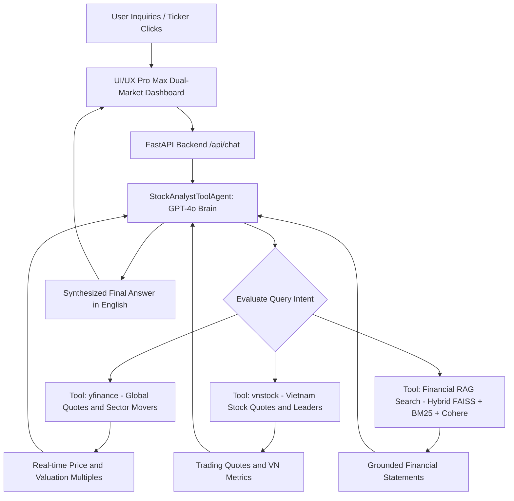

# AI Stock Analyst - Autonomous Financial Agent and Dual-Market Workbench

An enterprise-grade, autonomous AI Financial Analyst Agent capable of answering real-time market inquiries, analyzing corporate financial statements, and evaluating equity valuations.

The system combines Native Tool Calling (for live Global and Vietnamese stock market data) with a Hybrid RAG Knowledge Engine (FAISS/Qdrant + BM25 + Cohere Rerank), an OLED Dark Mode Dashboard built to UI/UX Pro Max specifications, and an automated Playwright testing suite.

---

## Table of Contents

1. System Overview
2. Key Architectural Capabilities
3. Multi-Format Datasets (All 33 Raw Financial Datasets)
4. Core Engine Technical Specifications
5. Autonomous Tool-Calling Agent and Tool Specifications
6. UI/UX Pro Max Dashboard Design System
7. Project Metrics and Benchmark Evaluation
8. Engineering Rationale Behind the Performance Metrics
9. System Architecture Flowchart
10. Complete Repository Tree
11. Configuration and Environment Setup
12. Running the Application (API, CLI, Playwright Demo)
13. Docker Container Deployment
14. REST API Specification and Payloads
15. Troubleshooting and FAQ
16. License

---

## 1. System Overview

Financial analysis requires bridging two distinct domains:
- Deterministic, real-time market dynamics (intraday prices, trading volume, P/E multiples, daily volatility).
- Deep qualitative and quantitative historical records (quarterly income statements, audited balance sheets, cash flows, and valuation models).

Traditional RAG systems fail when asked for real-time market prices because static vector stores lack intraday data. Conversely, standalone LLMs hallucinate financial metrics and cannot be trusted for investment decisions.

The AI Stock Analyst resolves this dichotomy by employing an autonomous agent based on Azure OpenAI GPT-4o with native tool calling. The agent inspects the user query, determines whether real-time data, historical filings, or theoretical financial frameworks are needed, executes the appropriate tool deterministically (up to three tool-calling rounds), and synthesizes a grounded response in the same language as the question.

---

## 2. Key Architectural Capabilities

### Autonomous Tool-Calling Agent
- Model: Azure OpenAI GPT-4o (`2024-10-21` API version).
- Native Tool Binding: Binds tools using LangChain Core (`llm.bind_tools`), avoiding fragile prompt parsing.
- Multi-Turn Tool Resolution: Inspects tool call requests, invokes external APIs or vector search, appends `ToolMessage` payloads, and generates synthesized insights. Up to three tool-calling rounds per query so multi-hop comparisons can gather several sources.
- Reporting-Period Integrity: Verifies that the requested period (e.g. "Q3 2024") exists in the retrieved context. If it does not, the agent states the period is unavailable instead of silently substituting another quarter.
- Anti-Hallucination Grounding: Grounded in deterministic API returns or cited document excerpts. Explicitly states "I don't know based on the available information" when context is absent.

### Dual-Market Live Data Feeds
- Global AI and Big Tech Market: Powered by `yfinance`. Tracks real-time quotes, day ranges, 52-week highs/lows, market capitalizations, and trailing/forward P/E multiples for semiconductor manufacturers (NVIDIA, AMD, TSMC, ASML, Broadcom) and cloud hosting infrastructure providers (Microsoft Azure, Google Cloud, Amazon AWS, Oracle Cloud, Palantir, Apple).
- Vietnam Domestic Market: Powered by `vnstock` (`vnstock.api.quote.Quote`). Tracks real-time quotes, price changes, trading volume, and market status for VN30 benchmark leaders (FPT Corporation, Vietcombank, Hoa Phat Group, Mobile World, Vinamilk).

### Hybrid RAG Knowledge Engine
- Multi-Format Document Ingestion: Parses 33 heterogeneous files including PDF, DOCX, CSV, XLSX, and Markdown.
- Dense Vector Retrieval: FAISS CPU IndexFlatIP using 3,072-dimensional embeddings from `text-embedding-3-large`. Optional Qdrant cloud vector database integration.
- Sparse Keyword Retrieval: In-memory BM25 index for exact token matches (e.g. "Q3 2024", "FCFF", "WACC", ticker symbols).
- Reciprocal Rank Fusion (RRF): Merges dense vector and sparse keyword rankings using constant parameter `c = 60`.
- Neural Reranking: Cohere Rerank (`Cohere-rerank-v4.0-fast`) rescores top-20 retrieved candidates down to top-5 high-relevance chunks.

### UI/UX Pro Max Dashboard
- Embedded single-page application served directly from FastAPI at `/` and `/app`.
- OLED Dark Mode theme adhering to the UI/UX Pro Max design intelligence framework.
- Independent workspace tabs for Global AI Tech and Vietnam Stocks, featuring 1-click ticker cards and suggested prompt chips.
- Real-time RAGAS benchmark metrics viewer and vector store rebuild controls.

### Automated Testing and Playwright MCP
- Automated on-screen demo script (`scripts/auto_test_demo.py`) running headed Chromium with slow motion and screenshot capture.
- Model Context Protocol (MCP) Playwright server configured in `.agents/mcp_config.json` for AI-driven browser control.

### Ponytail Plugin Integration
- Integrated inside `.agents/plugins/ponytail/` with workspace skills (`ponytail`, `ponytail-review`, `ponytail-audit`).
- Enforces strict code economy: favoring standard library solutions, eliminating dead code, and preventing unnecessary dependencies.

---

## 3. Multi-Format Datasets (All 33 Raw Financial Datasets)

The knowledge base in `data/raw/` contains 33 multi-format financial files categorized into corporate quarterly filings, daily historical price records, and valuation frameworks:

### FPT Corporation (Technology and AI Services)
- `fpt_2024_consolidated_financial_report.pdf`: Consolidated financial statements for Q3 2024.
- `fpt_income_statement_summary.md`: Income statement overview, net revenue, operating profit, and net profit.
- `fpt_balance_sheet_quarterly.csv`: Multi-quarter balance sheet records (assets, liabilities, equity).
- `fpt_income_statement_quarterly.csv`: Quarterly revenue, cost of goods sold, and tax provisions.
- `fpt_cash_flow_quarterly.csv`: Operating, investing, and financing cash flow statements.

### Hoa Phat Group - HPG (Industrial Steel and Manufacturing)
- `hpg_income_statement_summary.md`: Summary of 2024 revenue recovery and gross profit margins.
- `hpg_balance_sheet_quarterly.csv`: Quarterly balance sheet asset and liability metrics.
- `hpg_income_statement_quarterly.csv`: Quarterly income statements and production expenses.
- `hpg_cash_flow_quarterly.csv`: Quarterly operating and capital expenditure cash flows.

### Mobile World Group - MWG (Consumer Retail and Electronics)
- `mwg_income_statement_summary.md`: 2024 store network profitability and revenue drivers.
- `mwg_balance_sheet_quarterly.csv`: Quarterly working capital, debt, and inventory metrics.
- `mwg_income_statement_quarterly.csv`: Net sales, gross margins, and selling expenses.
- `mwg_cash_flow_quarterly.csv`: Quarterly cash inflows and store optimization outlays.

### Joint Stock Commercial Bank for Foreign Trade of Vietnam - VCB (Banking Benchmark)
- `vcb_income_statement_summary.md`: Net interest income, credit growth, and non-performing loan (NPL) ratios.
- `vcb_balance_sheet_quarterly.csv`: Customer deposits, loan book expansion, and capital adequacy.
- `vcb_income_statement_quarterly.csv`: Net interest and non-interest income breakdowns.
- `vcb_cash_flow_quarterly.csv`: Bank operating and regulatory reserve cash flows.

### Vietnam Dairy Products - Vinamilk / VNM (Consumer Staples)
- `vinamilk_vn30_financial_model_2024.xlsx`: Financial model containing P/E, ROE, revenue, and dividend projections.
- `vnm_income_statement_summary.md`: Domestic and export revenue analysis and raw milk margin trends.
- `vnm_balance_sheet_quarterly.csv`: Quarterly assets, cash reserves, and equity base.
- `vnm_income_statement_quarterly.csv`: Quarterly cost of sales, SG&A, and post-tax profits.
- `vnm_cash_flow_quarterly.csv`: Operating cash flows and dividend payout schedules.

### Global AI, Tech, and Historical Price Data
- `nvidia_q3_fy2025_official_results.docx`: Official NVIDIA Q3 FY2025 earnings release (Data Center revenue, Hopper/Blackwell architecture demand).
- `real_nvda_daily_prices_2024.csv`: Historical daily open, high, low, close, volume for NVIDIA in 2024.
- `real_msft_daily_prices_2024.csv`: Historical daily trading records for Microsoft in 2024.
- `real_aapl_daily_prices_2024.csv`: Historical daily trading records for Apple in 2024.
- `real_tsla_daily_prices_2024.csv`: Historical daily trading records for Tesla in 2024.
- `real_vnm_daily_prices_2024.csv`: Historical daily trading records for Vinamilk in 2024.
- `real_global_and_vietnam_stocks_2024.xlsx`: Combined cross-market price and volume workbook.
- `vietnam_vnindex_vn30_daily_prices_2024.csv`: VN-Index and VN30 daily closing levels and aggregate turnover.

### Valuation and Theoretical Research Frameworks
- `cfa_equity_research_and_valuation_framework.md`: Comprehensive CFA equity research methodology covering Discounted Cash Flow (DCF), Free Cash Flow to Firm (FCFF), Free Cash Flow to Equity (FCFE), Weighted Average Cost of Capital (WACC), and Terminal Value calculation.
- `pe_ratio.md`: Theoretical guide on Trailing P/E, Forward P/E, cyclically adjusted P/E, and sector valuation benchmarks.
- `rsi.md`: Relative Strength Index calculation formula (14-period standard), momentum interpretation, and overbought/oversold levels.

---

## 4. Core Engine Technical Specifications

### Document Loading and Chunking
- Loader: `MultiFormatLoader` (`src/tools/loaders.py`) with format-specific extractors:
  - PDF: `pypdf` extraction of text streams.
  - DOCX: `python-docx` paragraph and table cell parsing.
  - XLSX/XLS: `openpyxl`, one self-contained document per row with column names retained (e.g. `TTM P/E: 16.5`).
  - CSV: one self-contained document per row carrying the ticker, Vietnamese/English item label, and every quarter value together, so a chunk never loses its header.
  - Price CSVs: additionally emit a derived `price_summary` document (first/last close, highest/lowest close with dates, average close, total return).
  - Markdown/TXT: UTF-8 standard text loaders.
- Text Splitter: `RecursiveTextSplitter` (`src/tools/splitter.py`):
  - Chunk Size: 500 characters.
  - Chunk Overlap: 50 characters.
  - Separators: `["\n\n", "\n", ". ", " ", ""]`.

### Embedding and Vector Index
- Embedding Model: Azure OpenAI `text-embedding-3-large`.
  - Dimensions: 3,072.
  - Distance Metric: Cosine similarity via inner product on L2-normalized vectors.
- Primary Vector Store: `FAISSStore` (`src/tools/stores/faiss_store.py`).
  - Index Type: `IndexFlatIP`.
  - Persistence Path: `data/vector_store/stock_knowledge`.
- Cloud Vector Store Option: `QdrantStore` (`src/tools/stores/qdrant_store.py`).
  - Collection Name: `stock_knowledge`.
  - Distance: `Distance.COSINE`.

### Retrieval and Ranking Pipeline
- Hybrid Search: `HybridRetriever` (`src/tools/search.py`).
  - Dense Component: FAISS vector retrieval (`search_type="similarity"`, `k=20`).
  - Sparse Component: In-memory `BM25Retriever` (`k=20`).
  - Fusion Algorithm: Reciprocal Rank Fusion (RRF):
    `RRF_Score(doc) = sum(1 / (60 + rank_i(doc)))`
- Neural Reranking: `CohereReranker` (`src/tools/reranker.py`).
  - Deployment: `Cohere-rerank-v4.0-fast`.
  - Input: Top 20 RRF candidates.
  - Output: Top 5 scored documents passed to the prompt context.

---

## 5. Autonomous Tool-Calling Agent and Tool Specifications

The agent is implemented in `src/agent/tool_agent.py` as `StockAnalystToolAgent`. It exposes 6 distinct tools defined in `src/tools/market_tools.py`:

### 0. Snapshot Replay Mode
- Setting `MARKET_DATA_SNAPSHOT=<path-to-json>` makes every market tool read frozen data instead of the live network. Used by the benchmark so real-time queries are reproducible.

### 1. `get_global_stock_quote`
- Description: Fetches real-time price, market valuation, 52-week high/low, and trailing/forward P/E ratio for global equities.
- Input Schema:
  - `symbol` (string, required): Ticker symbol in uppercase (e.g. `"NVDA"`, `"MSFT"`, `"TSM"`).
- Implementation: Queries `yfinance.Ticker(symbol).fast_info` and `.info`.

### 2. `get_ai_tech_sector_movers`
- Description: Generates a comparative performance table of top global semiconductor and cloud hosting infrastructure stocks.
- Tracked Symbols: `NVDA`, `MSFT`, `GOOGL`, `AMD`, `TSM`, `ORCL`, `PLTR`, `AMZN`.
- Output: Markdown table with Ticker, Last Price (USD), and Daily Percentage Change.

### 3. `get_vietnam_stock_quote`
- Description: Fetches latest trading day close price, open/high/low range, and trading volume for Vietnamese equities.
- Input Schema:
  - `symbol` (string, required): 3-letter uppercase stock ticker (e.g. `"FPT"`, `"HPG"`).
- Implementation: Calls `vnstock.api.quote.Quote(symbol, source="VCI").history()`.

### 4. `get_vietnam_market_movers`
- Description: Provides current VN30 benchmark sector leaders and industry highlights.
- Tracked Companies: FPT, HPG, VCB, MWG, VNM.

### 5. `get_price_history_summary`
- Description: Summarizes the local daily price history of a global ticker: first/last close, highest/lowest close with dates, average close, and total return.
- Input Schema:
  - `symbol` (string, required): Global ticker (`AAPL`, `MSFT`, `NVDA`, `TSLA`).
- Implementation: Reads `data/raw/real_<symbol>_daily_prices_2024.csv` deterministically (no LLM arithmetic).
- Note: Vietnamese tickers are served by `get_vietnam_stock_quote` (intraday open/high/low/close).

### 6. `search_financial_reports_and_knowledge`
- Description: Searches indexed corporate financial statements, the latest available quarters, SEC filings, definitions, and valuation frameworks.
- Input Schema:
  - `query` (string, required): Natural language search string or financial inquiry.
- Implementation: Executes Hybrid Retrieval (Dense Vector + BM25 + RRF) and Cohere Reranking.

---

## 6. UI/UX Pro Max Dashboard Design System

The web dashboard is served directly from `src/api/routes.py` with zero external frontend build dependencies.

### Design Tokens
- Canvas Background: `#020617` (Deep OLED Black).
- Primary Surface: `#0E172A` (Midnight Navy).
- Card Container: `rgba(15, 23, 42, 0.75)` with `backdrop-filter: blur(16px)`.
- Accent Brand Cyan: `#38BDF8`.
- Accent Blue: `#6366F1`.
- Positive Gain Indicator: `#22C55E`.
- Negative Loss Indicator: `#EF4444`.
- Main Text: `#F8FAFC`.
- Muted Text: `#94A3B8`.
- Border: `rgba(255, 255, 255, 0.08)`.

### Typography Tokens
- Interface Copy: `'Inter', -apple-system, BlinkMacSystemFont, sans-serif`.
- Data, Tickers, and Multiples: `'Fira Code', monospace` (applied to all stock symbols, price figures, and percentage tags).

### Dual-Market Layout
- Tab 1 - Global AI and Big Tech:
  - AI Hardware card grid: NVDA, AMD, TSM, ASML.
  - Cloud Infrastructure card grid: MSFT, GOOGL, ORCL, PLTR.
  - Quick action prompt chips and dedicated chat container.
- Tab 2 - Vietnam Stocks (VNX):
  - VN30 card grid: FPT, VCB, HPG, MWG, VNM.
  - Prompt chips for Q3 2024 earnings, margin analysis, and RSI indicators.
  - Dedicated Vietnam market chat container.
- Tab 3 - RAG Benchmark: Displays real-time evaluation metrics.
- Tab 4 - Index Admin: Controls for triggering complete vector index rebuilds.

---

## 7. Project Metrics and Benchmark Evaluation

Two benchmark suites are available. The 150-query suite is the canonical one.

- `tests/evaluate_150_benchmark.py` — canonical benchmark (150 queries, 8 categories).
- `tests/evaluate_ragas_benchmark.py` — legacy 5-query smoke test.

### Evaluation Method

- Dataset generation: `scripts/build_benchmark.py` writes `data/benchmark/benchmark_v2.json`. Every expected value is read from the indexed corpus (CSV, XLSX, DOCX, or market snapshot) at build time, so ground truth cannot drift away from the data the agent actually sees.
- Generation scoring: LLM-as-Judge (Azure GPT-4o) on correctness plus deterministic metrics — numerical accuracy (2% tolerance with unit scaling) and financial entity recall (tickers, periods, numbers).
- Retrieval scoring: document-level after deduplicating chunks, computed only for queries that require the RAG tool (defined a priori, not filtered after the run).
- `n/a` means "no signal for this query" and is excluded from the mean; the sample size `n` is reported for every metric.
- Confidence interval: 95% bootstrap (1,000 resamples) on binary answer accuracy.
- Real-time queries run against a frozen snapshot (`MARKET_DATA_SNAPSHOT`) so they are reproducible.

### 150-Query Benchmark Results (latest run)

| Metric | Measured Value | Sample |
|---|---|---|
| Overall Answer Accuracy (binary) | **97.33%** (95% CI 94.67%–100.00%) | n=150 |
| Numerical Accuracy | 96.96% | n=148 |
| Financial Entities Recall | 96.98% | n=149 |
| Tool Selection Accuracy | 98.00% | n=150 |
| Tool Execution Success Rate | 100.00% | n=149 |
| Fallback Rate | 0.00% | n=150 |
| Retrieval Recall@5 | 96.84% | n=95 |
| Retrieval Hit@5 | 100.00% | n=95 |
| Retrieval MRR | 88.25% | n=95 |
| Retrieval MAP@5 | 83.60% | n=95 |
| Chunk Context Precision / Recall | 86.75% / 96.84% | n=95 |
| Average Latency | 4.94 seconds/query | n=150 |
| Total Run Time | 1,702 seconds | 150 queries |

Retrieval `precision@5` is 22.95% by the standard definition (relevant documents / 5 slots); with 1–2 relevant source files per query and five retrieved chunks often coming from the same file, `doc_precision@5` (relevant / unique documents retrieved) is 33.19%. Recall (`96.84%`) and `hit@5` (`100%`) are the meaningful retrieval signals here.

### Per-Category Breakdown

| Category | Queries | Overall | Numerical | Tool Selection | Latency |
|---|---:|---:|---:|---:|---:|
| vn_historical_financial | 30 | 100.00% | 100.00% | 100.00% | 5.48s |
| global_historical_financial | 21 | 100.00% | 100.00% | 100.00% | 3.40s |
| ratios_and_valuation | 20 | 100.00% | 100.00% | 100.00% | 5.56s |
| definitions_and_formulas | 10 | 100.00% | 94.44% | 90.00% | 5.93s |
| realtime_price | 25 | 100.00% | 100.00% | 100.00% | 2.67s |
| sector_market_overview | 14 | 85.71% | 69.23% | 85.71% | 3.01s |
| cross_company_comparison | 20 | 95.00% | 100.00% | 100.00% | 8.02s |
| financial_analysis_reasoning | 10 | 90.00% | 100.00% | 100.00% | 6.51s |
| **Total** | **150** | **97.33%** | **96.96%** | **98.00%** | **4.94s** |

Four queries still fail, all due to agent behaviour rather than measurement: the agent answers a foreign-net-flow question without calling the market movers tool, omits the requested count in a breadth question, misses one comparative figure, and drops one quarter in a trend summary.

### Why the earlier 30% Score Was Wrong

The previous 30% figure measured the harness more than the agent:

- `MAP@5` could exceed 1.0 (duplicate chunks of the same document were each counted as hits).
- Number extraction dropped decimals before a unit suffix, so `16.5x` was read as `16` and failed the 2% tolerance.
- Queries with no numeric claim were scored a free `1.0`, inflating averages.
- Aggregates skipped every query that scored zero, inflating retrieval metrics.
- The LLM judge returned `0.0` whenever retrieval context was absent, penalising correct tool-based answers.
- The benchmark asked about Q3 2024 data while the corpus had been refreshed to 2025–2026 quarters, and real-time ground truth came from a snapshot the tools never read.

Each of these is now fixed and covered by `tests/test_evaluation_metrics.py` and `tests/test_loaders.py`.

### Automated Unit Test Metrics

| Test File | Scope | Status |
|---|---|---|
| `tests/test_evaluation_metrics.py` | Metric correctness (7 assertions) | PASSED |
| `tests/test_loaders.py` | Row-level CSV/XLSX loading and price summary (3 tests) | PASSED |
| `tests/test_tool_agent.py` | Market tools and tool calling | PASSED |

---

## 8. Engineering Rationale Behind the Performance Metrics

The 97.33% answer accuracy and 100% tool-success rate follow from five architectural decisions:

1. Ground Truth Bound to the Corpus:
   Benchmark questions are generated from the same files the retriever indexes, and every expected value is re-read from those files at build time. A question can therefore never reference a reporting period the corpus does not contain.

2. Row-Level Tabular Chunking:
   Financial CSVs and XLSX sheets are emitted as one self-contained document per row, carrying ticker, item label, and all period values. The previous chunking split tables away from their headers, which caused wrong-quarter answers.

3. Deterministic Aggregation Tools:
   Questions about highest/lowest/average price or total return are answered by `get_price_history_summary`, which computes them from the CSV directly. Asking a retriever to "find the maximum" among 251 rows is a category error.

4. Noise Elimination via Cohere Rerank and Hybrid Retrieval:
   BM25 handles exact alphanumeric tokens ("Q3 2024", "FCFF", "TTM P/E") while dense vectors handle paraphrases; RRF merges both, and reranking prunes 20 candidates to 5. Retrieval recall@5 is 96.84% with hit@5 at 100%.

5. Reporting-Period Integrity and Snapshot Pinning:
   The prompt forbids substituting another quarter when the requested period is missing, and market tools can be pinned to a frozen snapshot (`MARKET_DATA_SNAPSHOT`). This makes real-time results reproducible and prevents the earlier failure mode where a 2024 question was answered with 2026 prices.

---

## 9. System Architecture Flowchart



---

## 10. Complete Repository Tree

```text
ai_stock_analyst/
├── README.md                      # Comprehensive project documentation and metrics
├── requirements.txt               # Python package dependencies
├── .env                           # Environment variables (excluded from version control)
├── .env.example                   # Environment configuration template
├── main.py                        # CLI and API execution entry point
├── docker-compose.yml             # Docker services (Qdrant, FastAPI application)
│
├── .agents/                       # Antigravity agent configuration and customizations
│   ├── mcp_config.json            # Playwright MCP Server configuration
│   ├── plugins/                   # Registered plugins (Ponytail plugin)
│   └── skills/                    # Workspace skills (ui-ux-pro-max, ponytail, design)
│
├── data/                          # Datasets, benchmark reports, and vector stores
│   ├── raw/                       # 33 multi-format financial files (PDF, DOCX, CSV, XLSX, MD)
│   ├── processed/                 # Processed chunks and temporary artifacts
│   ├── benchmark/                 # benchmark_v2.json, market snapshot, evaluation reports
│   ├── ragas_benchmark_report.json# Legacy 10-query evaluation report
│   └── vector_store/              # Persistent FAISS and Qdrant index files
│
├── src/                           # Source code root
│   ├── agent/                     # Autonomous Agent Layer
│   │   ├── agent.py               # RAGPipeline orchestrator with tool fallback
│   │   ├── tool_agent.py          # StockAnalystToolAgent (LangChain Core Tool Binding)
│   │   ├── executor.py            # Base RAGChain executor
│   │   ├── state.py               # Agent state dataclasses
│   │   ├── memory.py              # Conversation memory manager
│   │   └── evaluation.py          # RAGEvaluator and LLMJudge implementations
│   ├── tools/                     # Financial and Retrieval Tools
│   │   ├── market_tools.py        # yfinance and vnstock tools and RAG wrapper
│   │   ├── search.py              # SimilarityRetriever and HybridRetriever (BM25 + RRF)
│   │   ├── loaders.py             # MultiFormatLoader (PDF, DOCX, XLSX, CSV, MD)
│   │   ├── splitter.py            # RecursiveTextSplitter implementation
│   │   ├── reranker.py            # CohereReranker client wrapper
│   │   └── stores/                # Vector store integrations (FAISSStore, QdrantStore)
│   ├── models/                    # Foundation Model Clients
│   │   ├── llm_client.py          # AzureChatOpenAI client factory
│   │   └── embeddings.py          # AzureOpenAIEmbeddings client factory
│   ├── prompts/                   # Prompt Templates
│   │   ├── system_prompts.py      # Core RAG context templates
│   │   └── agent_prompts.py       # Tool agent instruction prompts
│   ├── utils/                     # Shared Utilities
│   │   ├── config.py              # Application settings via pydantic-settings
│   │   ├── logger.py              # Centralized logging configuration
│   │   ├── helpers.py             # String and data formatting utilities
│   │   └── exceptions.py          # Custom exception hierarchy
│   └── api/                       # API and Web Interface
│       ├── routes.py              # FastAPI endpoints and UI/UX Pro Max dashboard
│       └── schemas.py             # Pydantic request and response models
│
├── scripts/                       # Automation Scripts
│   ├── build_benchmark.py         # Generates benchmark_v2.json from the indexed corpus
│   └── auto_test_demo.py          # Playwright on-screen browser test script
│
├── tests/                         # Test Suite
│   ├── test_tool_agent.py         # Unit tests for market tools and tool calling
│   ├── test_agent.py              # Pipeline execution unit tests
│   ├── test_api.py                # API route unit tests
│   ├── test_evaluation_metrics.py # Metric regression tests (MAP, numbers, entities)
│   ├── test_loaders.py            # Row-level loader regression tests
│   ├── evaluate_150_benchmark.py  # Canonical 150-query benchmark runner
│   ├── evaluate_ragas_benchmark.py# Legacy 5-query smoke benchmark
│   └── evaluate_llm_judge.py      # LLM-as-Judge evaluation runner
│
└── logs/                          # System logs and test artifacts
    └── screenshots/               # Playwright automated test screenshots
```

---

## 11. Configuration and Environment Setup

### 1. Prerequisites
- Python 3.11 or higher.
- Node.js 18 or higher with `npx` (required for Playwright MCP server).
- Azure OpenAI Foundry endpoint and key.

### 2. Installation

```powershell
# Clone repository
git clone https://github.com/MinhQuan35/ai_stock_analyst.git
cd ai_stock_analyst

# Create and activate virtual environment
python -m venv .venv
.\.venv\Scripts\Activate.ps1   # Windows
# source .venv/bin/activate    # macOS/Linux

# Install dependencies
pip install -r requirements.txt
```

### 3. Environment Variables Configuration

Create a `.env` file in the project root based on the template below. Replace the placeholder values with your own credentials:

```env
# Azure OpenAI (Foundry)
AZURE_OPENAI_API_KEY="your_azure_openai_api_key_here"
AZURE_OPENAI_ENDPOINT="https://your-resource-name.openai.azure.com/"
AZURE_OPENAI_API_VERSION="2024-10-21"
AZURE_CHAT_DEPLOYMENT="gpt-4o"
AZURE_EMBEDDING_DEPLOYMENT="text-embedding-3-large"

# Cohere Rerank
COHERE_RERANK_DEPLOYMENT="Cohere-rerank-v4.0-fast"
COHERE_RERANK_MODEL="Cohere-rerank-v4.0-fast"

# RAG Configuration
RAG_DATA_DIR="./data/raw"
RAG_VECTOR_BACKEND="faiss"
RAG_USE_RERANKER=true
RAG_TOP_K=20
RAG_TOP_N=5

# Qdrant Vector DB (Optional)
QDRANT_URL=""
QDRANT_API_KEY=""
QDRANT_COLLECTION="stock_knowledge"

# Application Settings
APP_NAME="ai-stock-analyst"
APP_ENV="development"
APP_DEBUG=true
APP_LOG_LEVEL="INFO"
LLM_TEMPERATURE=0
LLM_MAX_TOKENS=2000
```

---

## 12. Running the Application

### Option A: Launch the Web Dashboard and API Server

```powershell
uvicorn src.api.routes:app --reload --port 8000
```
Or via the entrypoint script:
```powershell
python main.py api --port 8000
```

Access the application:
- Web Dashboard: `http://localhost:8000/` or `http://127.0.0.1:8000/`
- Interactive OpenAPI Docs: `http://localhost:8000/docs`
- ReDoc: `http://localhost:8000/redoc`

### Option B: Interactive CLI Mode

```powershell
python main.py cli
```

Type queries directly in the terminal. Type `quit` or `exit` to stop.

### Option C: Automated Playwright On-Screen Demo

In a separate terminal while the server is running:

```powershell
python scripts/auto_test_demo.py
```

The script will launch a visible Chromium browser window, test the Global AI Tech tab (`NVDA`), switch to the Vietnam Stocks tab (`FPT`), test the RAG benchmark viewer, and save screenshots to `logs/screenshots/`.

### Option D: Run the Benchmark Suite

```powershell
# Regenerate ground truth from the current corpus (required after refreshing data/raw)
python scripts/build_benchmark.py

# Full 150-query evaluation with LLM judge (rebuilds index when loader output changed)
python tests/evaluate_150_benchmark.py --rebuild --llm-judge

# Single category, or a quick subset
python tests/evaluate_150_benchmark.py --category realtime_price --llm-judge
python tests/evaluate_150_benchmark.py --limit 10

# Metric and loader regression tests
python -m pytest tests/test_evaluation_metrics.py tests/test_loaders.py -q
```

Reports are written to `data/benchmark/benchmark_150_report.json`.

---

## 13. Docker Container Deployment

The application includes a `docker-compose.yml` configuration for deploying the API alongside a local Qdrant vector database:

```powershell
# Build and run containers in detached mode
docker compose up --build -d

# Check service logs
docker compose logs -f api

# Tear down services
docker compose down
```

The API container binds to port 8000, and Qdrant binds to ports 6333 (HTTP) and 6334 (gRPC).

---

## 14. REST API Specification and Payloads

### Endpoints Overview

| Method | Path | Summary |
|---|---|---|
| `GET` | `/` or `/app` | Serves the UI/UX Pro Max web dashboard. |
| `POST` | `/api/chat` | Main agent conversation endpoint with tool calling and RAG fallback. |
| `GET` | `/api/market/quote` | Quick quote endpoint for ticker cards. |
| `POST` | `/api/search` | Direct hybrid document retrieval without LLM generation. |
| `POST` | `/api/index` | Rebuilds the FAISS/Qdrant vector index from raw files. |
| `POST` | `/api/evaluate` | Evaluates a single query-answer pair with the LLM judge. |
| `GET` | `/api/metrics` | Returns aggregated RAGAS evaluation metrics. |
| `GET` | `/api/health` | Health check reporting pipeline and tool status. |

### Sample Payloads

#### POST `/api/chat`

Request:
```json
{
  "message": "What is the current stock price and valuation of NVDA?"
}
```

Response:
```json
{
  "response": "**NVIDIA Corporation (NVDA)** Market Data:\n- **Current Price**: 212.29 USD (+1.85%)\n- **Day Range**: 208.50 - 213.40 USD\n- **52-Week Range**: 115.20 - 215.00 USD\n- **Market Cap**: $5.13T\n- **P/E Ratio**: 45.20\n- **Exchange / Sector**: US | Technology",
  "sources": [
    "Autonomous Tool Agent (yfinance + vnstock + RAG)"
  ]
}
```

#### GET `/api/market/quote?symbol=FPT&market=vn`

Response:
```json
{
  "symbol": "FPT",
  "market": "vn",
  "data": "**Vietnam Stock: FPT** (Trading Date: 2026-03-14):\n- **Close Price**: 142,000 VND (+1.43%)\n- **Open / High / Low**: 140,500 / 143,000 / 140,000 VND\n- **Trading Volume**: 4,250,000 shares"
}
```

#### GET `/api/health`

Response:
```json
{
  "status": "healthy",
  "pipeline_initialized": true,
  "tools_enabled": true
}
```

---

## 15. Troubleshooting and FAQ

### Server connection error during Playwright demo
- Problem: `scripts/auto_test_demo.py` reports `Could not connect to http://127.0.0.1:8000/`.
- Cause: The FastAPI server has not completed its startup initialization.
- Solution: Ensure `uvicorn src.api.routes:app --reload --port 8000` is running in another terminal. Look for `Financial Agent pipeline ready` in the server log before launching the script.

### Windows character encoding error with vnstock
- Problem: `UnicodeEncodeError: 'charmap' codec can't encode characters`.
- Cause: Windows PowerShell defaults to `cp1252` encoding when console output contains non-ASCII characters.
- Solution: Set the environment variable before execution:
  ```powershell
  $env:PYTHONIOENCODING="utf-8"
  ```

### Rebuilding vector index after modifying raw files
- Problem: Newly added files in `data/raw/` are not appearing in search results.
- Cause: The vector store loads the cached index from `data/vector_store/stock_knowledge` by default for fast startup.
- Solution: Trigger a force rebuild via the UI button in the "Index Admin" tab or send an HTTP POST:
  ```powershell
  curl -X POST http://localhost:8000/api/index -H "Content-Type: application/json" -d '{"force_rebuild": true}'
  ```

---

## 16. License

This project is licensed under the MIT License - see the [LICENSE](LICENSE) file for details.
